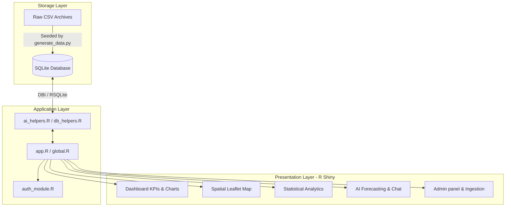
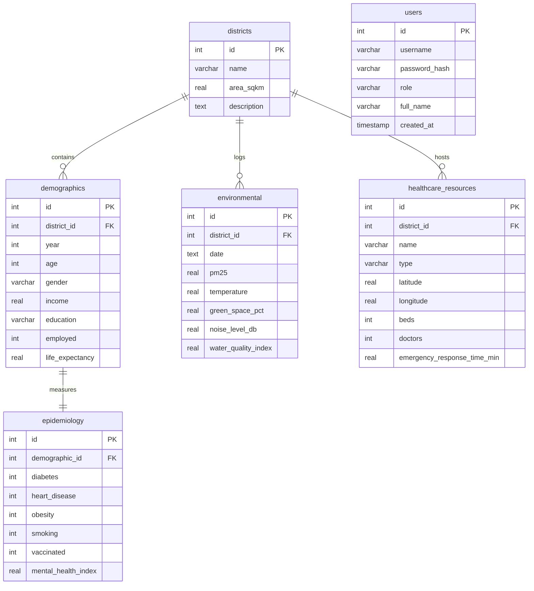

# AI Health Atlas - Municipal Health Planning Platform

The **AI Health Atlas** is a production-quality, interactive decision-support system designed for municipal health departments, city planners, and epidemiological researchers. It mimics the structural sophistication of the *Dresden Health Atlas*, allowing stakeholders to slice and dice demographics, chronic diseases, environmental factors, and healthcare resource indicators.

---

## 🏗️ System Architecture



---

## 📊 Database Schema (ER Diagram)

The SQLite database (`database/health_atlas.db`) contains five main relational tables and one authentication table:



---

## 🚀 Getting Started

### 📋 Prerequisites

To run this application locally, ensure you have:
1. **R** (v4.0.0 or higher)
2. **Python** (v3.8 or higher, for synthetic data generation)
3. Essential R Packages. Install them using the following command inside R:
   ```R
   install.packages(c("shiny", "bslib", "shinyWidgets", "leaflet", "plotly", "DT", "DBI", "RSQLite", "sf", "shinyjs", "openssl", "testthat"))
   ```

### ⚡ Step 1: Generate the SQLite Database
Run the standard Python pipeline script to set up tables and seed **52,000 resident records**:
```bash
python generate_data.py
```
This command creates:
- `database/health_atlas.db` (seeded SQLite database)
- `data/raw/demographics.csv`, `data/raw/epidemiology.csv`, `data/raw/environmental.csv` (raw backups)

### 💻 Step 2: Run the Shiny App
Start the dashboard from the R console:
```R
shiny::runApp(".", port = 8080)
```
Open [http://localhost:8080](http://localhost:8080) in your browser.

---

## 🔒 Demo Credentials

The platform features role-based access control (RBAC):
- **Admin**: `admin` / `admin123` *(Full access + User creation + CSV ingestion)*
- **Researcher**: `researcher` / `research123` *(Read-only access to all dashboards, analytics, forecasting, and data exports)*
- **Viewer**: `viewer` / `view123` *(Access to primary KPIs, charts, and Leaflet Map only)*

---

## 🐳 Containerized Deployment (Docker)

To build and run the application inside a Docker container:

1. **Build the Image**:
   ```bash
   docker build -t ai-health-atlas .
   ```
2. **Run the Container**:
   ```bash
   docker run -d -p 3838:3838 -v $(pwd)/database:/srv/shiny-server/database ai-health-atlas
   ```
3. Access the portal at [http://localhost:3838](http://localhost:3838).

---

## 🧪 Running Unit Tests

The backend is fully validated with unit tests. Run the test suite:
```R
source("tests/test_runner.R")
```

---

## 🔮 Future Improvements & Scaling

1. **PostgreSQL Migration**: Swap SQLite for a PostgreSQL database cluster to support concurrent transaction logs and write operations.
2. **GeoJSON Boundaries**: Integrate real municipal boundary shapefiles (GeoJSON format) for Dresden to align maps with physical boundaries.
3. **Advanced Time Series**: Transition linear projections to neural net forecasting (LSTM) or ARIMA via R's `forecast` library.
4. **HuggingFace API Integration**: Hook the NLP Chatbot up to an on-premises Llama model API for advanced text reasoning and report writing.
